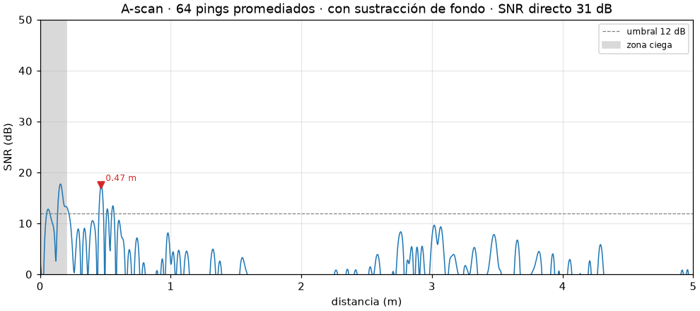
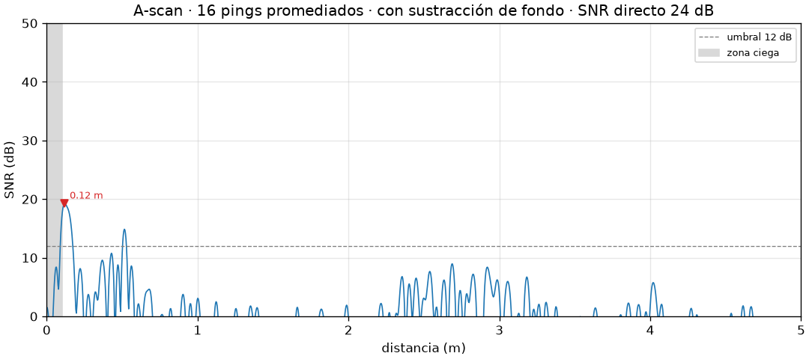
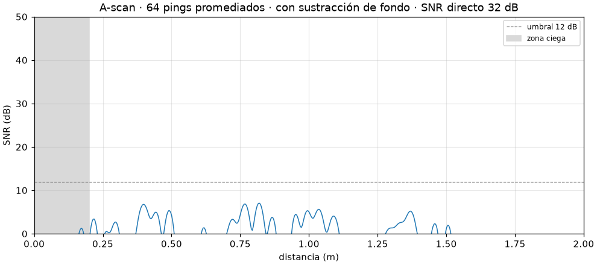
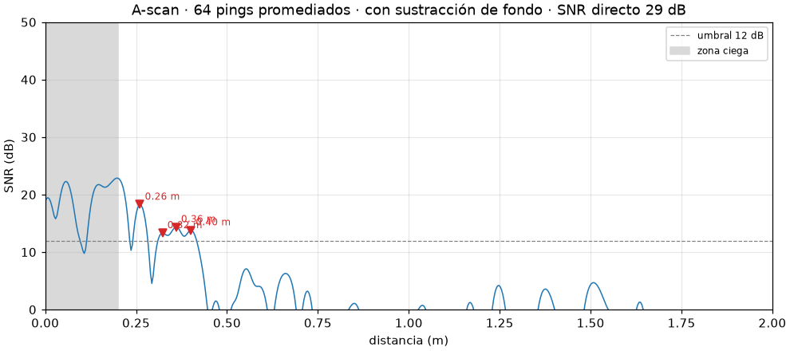
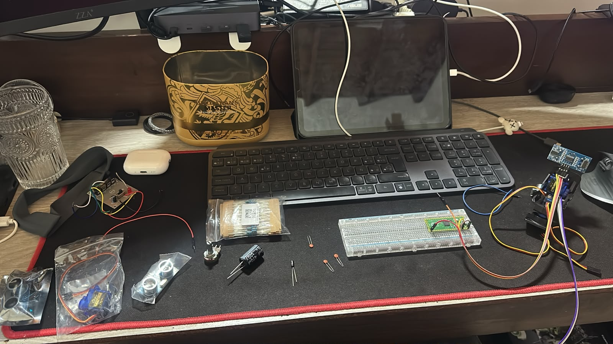
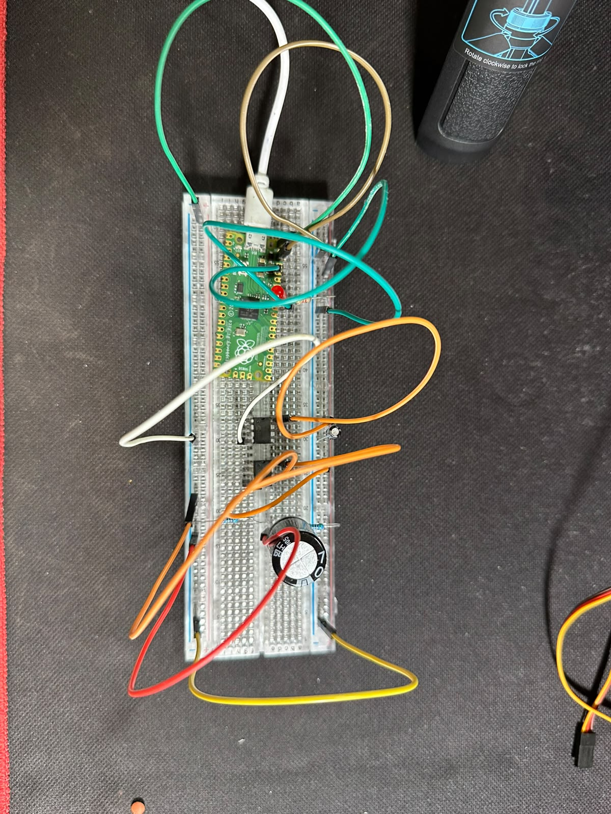

# sonar — sonar acústico con el parlante y el micrófono del computador

Prueba de concepto de un sonar activo (al estilo del de *The Dark Knight*, pero honesto sobre sus
límites): emite un chirp casi ultrasónico por el parlante, graba con el micrófono integrado y
mide distancias a superficies por el tiempo de vuelo del eco.

> ⚠️ **Seguridad.** El casi-ultrasonido (18–22 kHz) a alto volumen **molesta a perros y gatos**
> (lo oyen perfectamente) y puede **dañar tweeters** de parlantes pequeños, que no están hechos
> para energía sostenida en esa banda. La amplitud digital por defecto es baja (`0.1`) y existe un
> tope duro (`--max-amplitude`, por defecto `0.5`) que el adaptador de audio verifica antes de
> reproducir. Mantén también moderado el volumen del sistema operativo. Si tienes mascotas cerca,
> usa sesiones cortas o la banda audible.

## Sustentación

- [Documentación del sonar](https://ruiiz-dev.github.io/batman/) y [hardware del sonar 3D](https://ruiiz-dev.github.io/batman/hardware.html), con materiales y conexiones.
- Código de las pruebas en la Raspberry Pi Pico: [`pico/`](pico/).

### Mediciones

| Prueba | Resultado |
| --- | --- |
| Objeto frente al sonar |  |
| Sin objeto |  |
| Cuarto vacío |  |
| 30 cm contra 80 cm |  |

### Montaje

| Componentes | Protoboard |
| --- | --- |
|  |  |

## Cómo funciona

1. Se emite un tren de *N* chirps lineales (por defecto 18–22 kHz, 8 ms, ventana Tukey), uno cada
   60 ms, precedido por 50 ms de silencio.
2. `sounddevice.playrec` reproduce y graba con el mismo reloj, así que los N pings quedan
   rígidamente espaciados en la grabación.
3. Filtro pasa-banda de fase cero → **filtro adaptado** (correlación cruzada con el chirp emitido)
   → envolvente de Hilbert. El chirp de 8 ms (2.7 m de largo en el aire) se comprime a un pico de
   ~0.25 ms.
4. **t0 = camino directo.** La primera llegada fuerte es el sonido que viaja directo del parlante al
   micrófono. Todas las distancias se miden respecto a ese pico, por lo que la latencia desconocida
   del sistema de audio (10–300 ms en Windows) se cancela por completo.
5. Los N pings se re-anclan cada uno a su camino directo y se **promedian coherentemente**
   (el ruido baja √N; 16 pings ≈ +12 dB), luego se alinean con precisión sub-muestra.
6. Opcionalmente se **resta el perfil de fondo** grabado con `calibrate` (acoplamiento por el chasis,
   camino directo, mesa…), con una ganancia por mínimos cuadrados que absorbe cambios de volumen.
7. **Detección:** picos sobre un umbral OS-CFAR (mediana local) y un SNR mínimo global, descartando
   lóbulos laterales de llegadas más fuertes según la autocorrelación real del chirp.
8. `distancia = c · (t_eco − t0) / 2`, con `c = 331.3·√(1 + T/273.15)` (343.2 m/s a 20 °C).

Resolución en distancia: `c / (2·B)` → 4.3 cm con 4 kHz de banda; 2.1 cm con 8–16 kHz.
La precisión (no la resolución) es sub-centimétrica en datos sintéticos gracias a la interpolación
parabólica del pico.

## Instalación

Requiere Python ≥ 3.11 y [uv](https://docs.astral.sh/uv/).

```bash
uv sync                 # crea .venv con dependencias + grupo dev (pytest, hypothesis)
uv run sonar --help
```

En Linux instala PortAudio: `sudo apt install libportaudio2`.

## Comandos

Las opciones globales van **antes** del comando, p. ej. `sonar --band audible --pings 32 ping`.

| Opción global | Por defecto | Descripción |
|---|---|---|
| `--band ultrasonic\|audible` | ultrasonic | Preset 18–22 kHz o 8–16 kHz |
| `--f-start/--f-end` | 18000/22000 | Banda manual (Hz) |
| `--fs` | 48000 | Tasa de muestreo |
| `--chirp-ms`, `--window` | 8, tukey | Duración y ventana del chirp |
| `--pings` | 16 | Pings promediados |
| `--amplitude`, `--max-amplitude` | 0.1, 0.5 | Amplitud y tope de seguridad |
| `--temperature`, `--sound-speed` | 20 °C, — | Velocidad del sonido |
| `--min-range`, `--max-range` | 0.15, 5 m | Ventana de búsqueda |
| `--min-snr` | 12 dB | SNR mínimo de un eco |
| `--direct-path` | 0 m | Separación parlante–micrófono (corrige el sesgo) |
| `--input`, `--output` | por defecto del SO | Índice o parte del nombre del dispositivo |

### `sonar devices`
Lista dispositivos, host API, canales y tasas de muestreo soportadas. Marca los predeterminados.

### `sonar diagnose [--duration 2] [--min-snr 15] [--plot respuesta.png]`
Mide el ruido ambiente, reproduce un barrido 1 kHz → 23 kHz y calcula el SNR por frecuencia.
Muestra una tabla por kHz, avisa si tu banda actual está fuera de la respuesta del hardware y
recomienda, en orden de preferencia: la mejor banda ≥ 17 kHz (casi inaudible), la mejor dentro del
fallback audible 8–16 kHz, o cualquier banda usable. Imprime el comando exacto a usar.

### `sonar calibrate [--out .sonar/background.npz]`
Graba el perfil de fondo. Hazlo **en la posición de medida, apuntando a espacio libre** (sin el
objetivo delante): todo lo que esté presente al calibrar será restado después. El archivo guarda una
huella de la configuración; si cambias banda, fs, chirp o intervalo, `ping` lo rechazará y pedirá
recalibrar.

### `sonar ping [--background RUTA | --no-background] [--plot a.png] [--show] [--json]`
Una medición. Imprime los ecos más fuertes (distancia, retardo, SNR). Usa automáticamente
`.sonar/background.npz` si existe.

### `sonar live [--history 120]`
A-scan en tiempo real arriba y *waterfall* abajo. Los errores transitorios (SNR bajo, clipping) se
muestran en la ventana sin cortar el loop. Cierra la ventana o Ctrl+C para salir.
Tip: `sonar --pings 4 live` refresca más rápido.

### `sonar sweep [--out sweep.png] [--show]`
Gira el equipo a mano; en cada posición escribe el ángulo y presiona Enter para medir. Enter vacío
termina y genera un gráfico polar tipo radar (ángulo × distancia, color = SNR, punto rojo = eco
más fuerte).

## Montaje físico recomendado

- **Cuarto silencioso**, sin ventiladores ni música. El aire acondicionado mete ruido en banda.
- Equipo sobre una mesa, **apuntando a una pared plana y dura a 0.5–2 m**, con espacio libre entre
  ambos. Las superficies blandas (cortinas, sofás) absorben y difunden.
- Para validar: mide la distancia con una cinta y compárala con `sonar ping`; si hay un sesgo
  constante, es la separación parlante–micrófono: corrígelo con `--direct-path <metros>`.
- Evita superficies a < 15 cm (zona ciega: el eco se solapa con el camino directo).
- Calibra (`sonar calibrate`) en la misma posición pero apuntando a espacio libre, y no muevas el
  equipo entre la calibración y la medida.

### Configuración del sistema (importante)

- Usa el **micrófono y parlantes integrados**, no un headset (`--input`/`--output`).
- **Desactiva** supresión de ruido, "mejoras de audio", cancelación de eco y AGC (en Windows:
  Propiedades del dispositivo → Mejoras / Efectos de audio; apps tipo "AI Noise-cancelling"). Estos
  filtros eliminan precisamente el chirp y el eco.
- En Windows prefiere el dispositivo **WASAPI** a 48 kHz: MME/DirectSound remuestrean y pueden
  recortar todo lo que esté sobre ~20 kHz.
- Muchos parlantes de laptop caen fuerte sobre 18 kHz: si `diagnose` lo confirma, usa
  `--band audible` (se oye, pero funciona y tiene mejor resolución).

### Windows: lecciones de una laptop real (ASUS ROG/TUF)

- **Usa WASAPI exclusivo** (`--host-api WASAPI --exclusive`). En modo compartido Windows aplica
  el procesamiento de voz del micrófono (cancelación de eco, compuerta de ruido, AGC): borra el chirp
  tras los primeros pings, mete jitter de decenas de muestras entre pings y corta sobre ~8 kHz.
- **Elige dispositivos por nombre**, no por índice: los índices cambian al conectar o desconectar
  un monitor o unos audífonos. Ejemplo:
  `sonar --host-api WASAPI --exclusive --input "Varios micr" --output "Altavoces (Realtek" ping`
- **Con la tapa cerrada** el micrófono integrado se apaga.
- **Armoury Crate → "Cancelación de ruido con IA bidireccional"** deshabilita el micrófono físico y
  deja sólo un micrófono virtual "AI Noise-cancelling Input". Al apagarla puede que tengas que
  rehabilitar a mano el micrófono (`mmsys.cpl` → Grabación → mostrar deshabilitados → Habilitar) y
  quitarle el *mute*.
- Los primeros pings salen distintos porque el amplificador despierta del ahorro de energía; por eso
  existen los `--warmup` pings, que se emiten pero no se promedian.
- Si el cuarto reverbera, separa más los pings (`--interval-ms 150`–`250`) para que la cola del
  ping anterior no se sume coherentemente al siguiente.

## Errores y cómo se reportan

Cada error se muestra con un mensaje y un **"Cómo resolverlo"** (código de salida 2):

| Situación | Detección |
|---|---|
| Dispositivo inexistente | `query_devices` falla → sugiere `sonar devices` |
| Sample rate no soportado | `check_*_settings` de PortAudio |
| Permiso de micrófono denegado | La grabación es silencio digital exacto (Windows/macOS no dan error, entregan ceros) o PortAudio devuelve error de host; instrucciones según el SO |
| Clipping | Muestras ≥ 0.99 FS → bajar amplitud/volumen/ganancia |
| SNR bajo | SNR del camino directo < 15 dB en un ambiente ruidoso |
| Banda fuera de respuesta | Ambiente silencioso pero el chirp no aparece → sugiere `diagnose` / `--band audible` |
| Amplitud insegura | Configuración > tope o señal > tope en el adaptador |
| Perfil de fondo incompatible | Huella de configuración distinta |

## Tests

```bash
uv run pytest
```

Corren sin hardware: `FakeAudioDevice` alimenta la cadena real con un simulador
(`sonar.simulation`) que modela latencia aleatoria, camino directo, reflectores con retardos
fraccionarios exactos (FFT), respuesta en frecuencia del hardware, ruido y clipping del ADC.
Cubren: error < 2 cm en distancia (incluido un test de propiedades con Hypothesis sobre distancia,
ganancia, latencia y semilla), múltiples ecos, ecos solapados en el tiempo, ecos por debajo de la
resolución, sin ecos (sin falsas alarmas), SNR bajo, ganancia del promediado coherente, clipping,
micrófono bloqueado, banda fuera de respuesta, fallback audible, sustracción de fondo, la CLI
completa y las gráficas.

Si pytest no puede escribir en su carpeta temporal del sistema, usa
`uv run pytest --basetemp=.pytest_tmp`.

## Arquitectura

```
src/sonar/
  config.py       SonarConfig inmutable + validación + magnitudes derivadas
  signal.py       chirp, tren de pings, barrido (funciones puras)
  audio.py        puerto AudioDevice, adaptador sounddevice, FakeAudioDevice
  simulation.py   escena acústica sintética (para el fake y los tests)
  processing.py   pasa-banda, filtro adaptado, Hilbert, promediado, fondo, pipeline
  detection.py    OS-CFAR + rechazo de lóbulos laterales → lista de ecos
  diagnostics.py  respuesta en frecuencia y recomendación de banda
  engine.py       servicio: orquesta dispositivo + dominio (measure/calibrate/diagnose)
  viz.py          A-scan, live (A-scan + waterfall), respuesta, radar polar
  cli.py          typer; capa delgada, traduce errores a mensajes accionables
```

El dominio (`signal`, `processing`, `detection`, `diagnostics`) no hace I/O de audio; sólo
`audio.SoundDeviceAudio` toca `sounddevice`, y se importa de forma perezosa.

## Limitaciones conocidas

- Un único micrófono no da dirección: sólo distancia. El "radar" de `sweep` depende de que gires el
  equipo y de la directividad (pobre) del parlante.
- Los parlantes/micrófonos de laptop no están especificados sobre 20 kHz; la respuesta varía mucho
  entre modelos. `diagnose` existe por eso.
- Superficies pequeñas o blandas devuelven ecos débiles; las paredes y puertas funcionan mejor.
- La sustracción de fondo asume escena estática: mover el equipo o cambios de temperatura grandes
  dejan residuos; recalibra.
